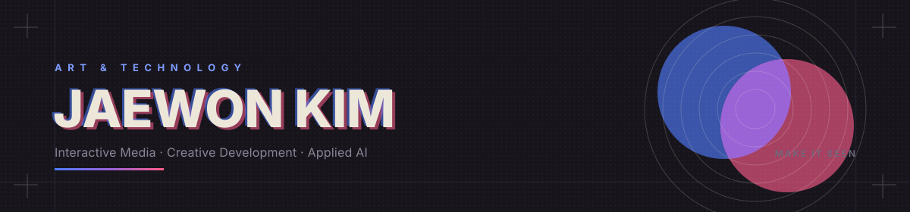
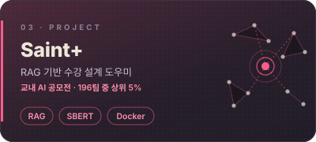
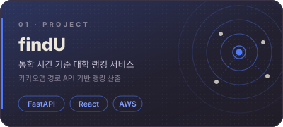
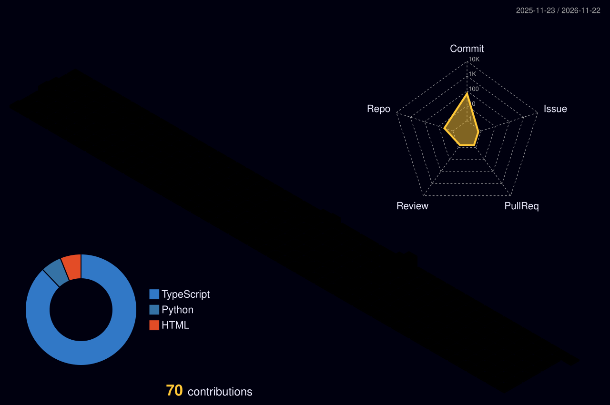

<picture>
  <source media="(prefers-color-scheme: dark)" srcset="assets/banner-dark.svg">
  <source media="(prefers-color-scheme: light)" srcset="assets/banner-light.svg">
  
</picture>

**김재원** · 서강대학교 아트&테크놀로지 / 컴퓨터공학 복수전공

실제로 쓰이는 것을 직접 만들고, 써 보면서 고쳐 나가는 일을 좋아합니다.
사용자의 이야기를 듣고 문제를 정의하는 일부터 직접 만들어 배포하는 일까지 해 왔습니다.

2026 서강대학교 생성형 AI 기반 아이디어 공모전 우수상 (196팀 중 3위) · 기술 구현 담당

기획부터 배포까지 1인 개발 · [Live Demo](https://find-u-iota.vercel.app/)

